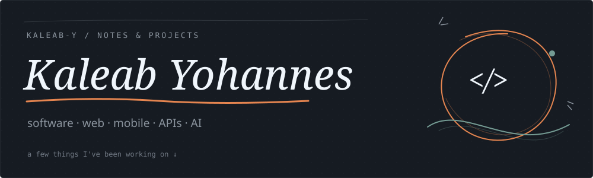
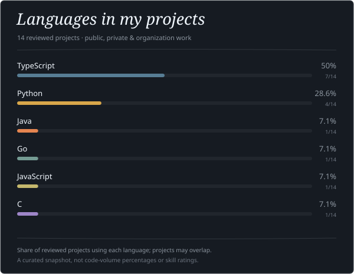

Hi, I'm Kaleab. I'm a software engineer who enjoys turning practical ideas into fast, dependable software. Most days you'll find me building full-stack applications and backend services with **TypeScript** and **Python**, designing APIs with **Next.js** and **FastAPI**, or experimenting with developer tooling.

I care about sensible architecture, clean interfaces, and code that's a pleasure to maintain. Some of my work lives here in the open; other commercial and team projects are in private repositories.

  
  
  
  

## Selected Builds

### [AI Tracker](https://github.com/Kaleab-y/AI-tracker)
> *A local developer observability dashboard to see where LLM requests spend tokens, time, and money.*

* **The Problem:** When experimenting with LLM APIs, token usage and latent costs are easy to lose track of until the end-of-month invoice arrives.
* **The Build:** Created a lightweight local proxy in **FastAPI** paired with a real-time **Next.js 14** dashboard. It intercepts requests, calculates live token burn against model pricing tables, and graphs request latency on the fly.
* **Stack:** `FastAPI` · `Next.js 14` · `TypeScript` · `SQLite` · `Docker`

### [Kulli](https://github.com/Kaleab-y/Demo_Truck_delivery_app)
> *An on-demand freight and cargo logistics engine bridging shippers and truck drivers.*

* **The Problem:** Freight booking in informal logistics markets often relies on disjointed phone calls and unpredictable spot rates.
* **The Build:** Engineered a dispatch web application with dynamic distance and price estimations, dispatch status queues, and dedicated operational views for cargo owners and truck operators.
* **Stack:** `Python` · `Flask` · `SQLite` · `Tailwind CSS`

### [Agri-Smart](https://github.com/birukabza/Agri-Smart)
> *A collaborative digital agriculture platform to organize farmer records and crop inventory.*

* **The Problem:** Smallholder agriculture workflows struggle with manual paper records and disjointed supply chain data.
* **The Build:** Collaborated with a team on full-stack **TypeScript & React** features, focusing on predictable client-side state, intuitive data ingestion forms, and clear dashboards.
* **Stack:** `TypeScript` · `React` · `Node.js`

### 🔍 Foundations in C & Low-Level Systems
> *Why low-level programming matters to me.*

Before building modern web applications, I spent significant time writing **C** from scratch: managing raw pointers, debugging memory leaks with Valgrind, and implementing data structures and UNIX utilities by hand. Digging into the lower layers gave me a much stronger intuition for how high-level runtimes, memory, and concurrency actually work. Explore the code in [alx-low_level_programming](https://github.com/Kaleab-y/alx-low_level_programming) and [DSA practice](https://github.com/Kaleab-y/DSA_questions).

---

## What's in My Stack

**Languages & Core**  

**Frontend & Mobile**  
 &nbsp;*Also: React Native, Expo*

**Backend & Storage**  

**DevOps & Tooling**  
 &nbsp;*Also: Playwright, Testing Library*

---

## By the Numbers

<b>About this breakdown</b>

A snapshot across 14 projects (public, private, and team repos):
- **TypeScript (50%) & Python (28.6%)** make up the bulk of my day-to-day production code.
- **C, Go, Java, and JavaScript (7.1% each)** reflect low-level systems exercises, foundational coursework, and exploratory services.

*Measured by project representation rather than raw line count.*

  

  

Activity totals above cover public repositories; the streak card includes anonymous private contributions.

Visual credits

Original notebook artwork. Logos from [Skill Icons](https://github.com/tandpfun/skill-icons); activity cards from [GitHub Stats Extended](https://github.com/stats-organization/github-stats-extended) and [Streak Stats](https://github.com/DenverCoder1/github-readme-streak-stats).

